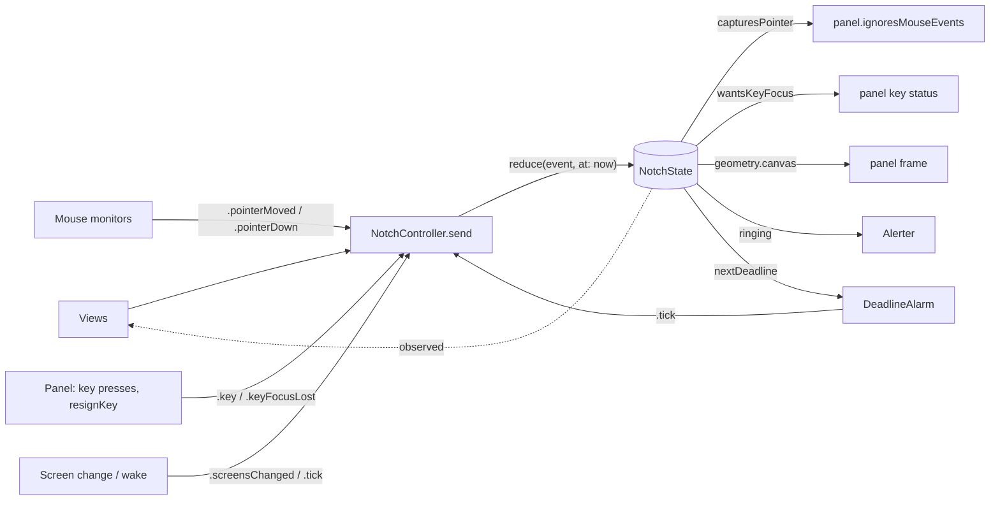

# Architecture

## Problem

A notch timer has two parts that each look simple. One is a countdown. The other is a window that sits over the menu bar without blocking it, opens on hover or click, and stays open while the user types. The hard parts come from time and from inputs arriving from many places: hover needs a dwell before opening and a grace period before closing; the deadline has to survive sleep and a stalled main thread; a Pause click can race the completion alarm; pointer input comes from two `NSEvent` monitors, key status from the panel, and screen changes and wake from notifications. If each source owns a `Timer` and a flag, the rules end up spread across callbacks nobody can test.

Constraints: Swift 6 strict concurrency; an agent app (`LSUIElement`); the notch rect comes from `NSScreen.safeAreaInsets` and the auxiliary top areas, with a fallback for screens without one; the panel must not take menu-bar clicks while closed; `UNUserNotificationCenter` needs an app bundle; and the deployment target is macOS 26 so the app runs in the `flotion-test` VM.

## Usage (caller's view)

Every caller looks like one of these three:

```swift
// 1. A view: the only way UI changes anything.
PillButton(title: "Pause") { send(.timer(.pause)) }

// 2. The shell: every input becomes an event; every output is a projection.
controller.send(.pointerMoved(NSEvent.mouseLocation, dragging: false))

// 3. A test: behaviour as data, no window, no sleeping.
var s = NotchState(geometry: g, now: t0)
s.reduce(.preset(TimerDuration(seconds: 60)!), at: t0)
s.reduce(.timer(.pause), at: t0.advanced(by: .seconds(61)))   // the alarm has not fired yet
#expect(s.ringing != nil)                                     // pause did not bring it back
```

## Shape



**One value, one mutator.** `NotchState` (in `NotchedCore`, no AppKit) holds `countdown`, `entry`, `surface` and `geometry`. `reduce(event, at: now)` is the only way to change it. The mutators on the parts are `internal`, so the app target has no second route.

**Time is timestamps, never counters.** `Countdown.running` stores a `ContinuousClock` deadline; remaining time is derived. `Surface` stores which side of the shape the pointer is on and since when, so dwell, grace and "Esc with the pointer resting on the notch does not reopen it" are comparisons. The domain holds no timers: `nextDeadline` is the earliest instant anything changes on its own, and the shell keeps one wake-up armed for it.

**Every event settles.** After applying an event, `reduce` settles the countdown and the surface against `now`, then applies one cross-cutting rule: opening the notch silences Done. So a late or duplicate alarm, or an extra `.tick` on wake, changes nothing, and a Pause after the deadline cannot bring a finished timer back.

**Projections, not effects.** The reducer returns no effect values. After each change, the controller matches AppKit to five projections, and each step does nothing if AppKit already matches. Replaying an event or reconciling twice converges.

**A fixed canvas.** The panel's frame is the union of every layout's rect and changes only when screens change. SwiftUI springs the black shape inside it. Click-through is `ignoresMouseEvents = !capturesPointer`, and one rect per layout answers both "is the pointer hovering?" and "does the window take this click?".

**Key focus only while editing.** A notch opened by hover never becomes key, so it never takes keystrokes. Clicking the HH:MM:SS display makes the non-activating panel key; the frontmost app stays in front, and gets the keyboard back when editing ends (the panel is ordered out and back while it may no longer become key, instead of calling `resignKey()`). Key presses go through `NotchPanel.sendEvent` to `.key` events, so there is no SwiftUI focus to manage.

**Interface depth.** The shell sees `NotchState` (four read-only parts and five projections), `NotchEvent` and `reduce`. Hidden behind that: the transition table, settle-first ordering, dwell, grace and re-entry suppression, the edit lock, digit entry and normalisation, rounding, layout sizes and the notch-rect math.

Deliberately not done: multiple timers, persistence across relaunch, launch at login, settings.

## Synthesis decision

Three candidates were designed in parallel (Claude Opus 5.5, GPT-6.2 Sol, Gemini 4 Neon) and judged against a rubric by GPT-6.2 Sol, which agreed on the base.

- **Base: candidate 1 (Opus).** One value, one reducer, level-triggered projections; pointer state that changes only on a crossing; a canvas derived from `NotchLayout.allCases`.
- **From candidate 3 (Gemini):** drag suppression (a drag over the closed notch does not open it or take the mouse), and notch-rect detection as pure, tested math (`NotchGeometry(screenFrame:topInset:auxiliaryTopLeft:auxiliaryTopRight:)`).
- **From candidate 2 (GPT):** handing the keyboard back by ordering the panel out and back instead of calling `resignKey()`.
- **From the cross-judge:** a timer that finishes while the notch is already open still rings (only *opening* the notch acknowledges, not *being* open); one public mutator instead of `reduce` plus `reducing`; and the shell re-samples the pointer when the layout changes under a still cursor, so the canvas never keeps taking clicks after Esc.
- **Rejected:** candidate 2's trigger strip below the notch (the user asked to hover the notch itself) and its resized window; candidate 3's effect-returning reducer and pointer position in observed state (every mouse move re-rendered SwiftUI).
- **Late constraints:** the ArcX layout (XcodeGen app + `NotchedKit` package, `Scripts/`, the Debug self-test) and testing in the Tart VM.

## Tradeoffs accepted

- We accept one `@Observable` property holding the whole state, which re-renders the root view on any change, in exchange for one owner and a trivial `next != state` check. Changes happen on crossings and keystrokes, not every frame.
- We accept a transparent panel permanently over about 410×180 pt at the top of the screen, click-through whenever the pointer is off the shape, in exchange for animation that never fights a window resize.
- We accept that the glance wings cover menu-bar space beside the notch while a timer runs.
- We accept that sleep does not pause the timer; if it ends during sleep, it rings on wake.
- We accept digit entry instead of a text field, in exchange for no parse-error state.

## Alternatives considered

- **Resize the panel per layout.** Hides less: the window frame and the SwiftUI shape become two animations that must stay in step, and hover still needs the global monitor while closed.
- **An observable object per concern** (a timer model with its own `Timer`, a hover controller with delayed tasks). The cross-cutting rules (opening silences the alert, editing blocks collapse, pause after the deadline) would live in callbacks between objects, and nothing could be tested without a window.
- **A reducer that returns effects.** Every effect becomes edge-triggered, so duplicates and losses need bookkeeping. Projecting level-triggered state gives idempotence for free.

## Open questions and risks

- Do menu-bar items beside the physical notch still get every click under the transparent canvas at `.statusBar` level? Verified in the VM only for the fallback pill; needs a check on a notched MacBook.
- Should an idle notch on an external display show the pill, or nothing until a timer runs?
- Should Done ever clear itself, or stay until dismissed (as now)?

## Next implementation step

Use it on the notched MacBook for a day; check menu-bar clicks beside the notch and full-screen Spaces first.
