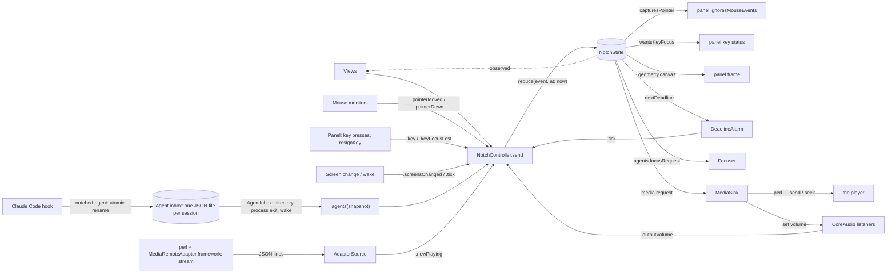

# Architecture

## Problem

A notch timer has two parts that each look simple. One is a countdown. The other is a window that sits over the menu bar without blocking it, opens on a click, closes when the pointer leaves, and stays open while the user types. The hard parts come from time and from inputs arriving from many places: closing waits out a grace period so an overshoot does not collapse it; Pomodoro phases must advance exactly once when a run ends; the deadline has to survive sleep and a stalled main thread; a Pause click can race the completion alarm; pointer input comes from two `NSEvent` monitors, key status from the panel, and screen changes and wake from notifications. If each source owns a `Timer` and a flag, the rules end up spread across callbacks nobody can test.

The notch also shows what music is playing and controls it. The player is another app, and since macOS 15.4 the private MediaRemote framework answers only Apple's own binaries, so reading it takes a helper process. Commands can silently fail, and the player's reports arrive late and repeat.

The notch also shows coding agents. They are other processes that Notched does not own: they start before it, outlive it, crash and get killed. So every agent input has to converge on "this is each session's status now", never on "an event happened".

Constraints: Swift 6 strict concurrency; an agent app (`LSUIElement`); the notch rect comes from `NSScreen.safeAreaInsets` and the auxiliary top areas, with a fallback for screens without one; the panel must not take menu-bar clicks while closed; and the deployment target is macOS 26 so the app runs in the `flotion-test` VM.

## Usage (caller's view)

Every caller looks like one of these three:

```swift
// 1. A view: the only way UI changes anything.
PillButton(title: "Pause") { send(.timer(.pause)) }

// 2. The shell: every input becomes an event; every output is a projection.
controller.send(.pointerMoved(NSEvent.mouseLocation, dragging: false))

// 3. A test: behaviour as data, no window, no sleeping.
var s = NotchState(geometry: g, now: t0)
s.reduce(.timer(.start), at: t0)                                // Focus 50
s.reduce(.tick, at: t0.advanced(by: .seconds(50 * 60)))
#expect(s.selection == .rest)                                  // the 10-minute break is next
```

## Shape



**One value, one mutator.** `NotchState` (in `NotchedCore`, no AppKit) holds `countdown`, `entry`, `surface` and `geometry`. `reduce(event, at: now)` is the only way to change it. The mutators on the parts are `internal`, so the app target has no second route.

**Time is timestamps, never counters.** `Countdown.running` stores a `ContinuousClock` deadline; remaining time is derived. `Surface` stores which side of the shape the pointer is on and since when, so the leave grace period is a comparison. The domain holds no timers: `nextDeadline` is the earliest instant anything changes on its own, and the shell keeps one wake-up armed for it.

**Every event settles.** After applying an event, `reduce` settles the countdown and the surface against `now`. A run that went from running to finished inside this call moves the selection to the next phase (focus → its break → the same focus), so the advance happens exactly once however often the finish is settled again. Then one cross-cutting rule: opening the notch acknowledges Done, which stops the pulse. There is no sound and no notification. So a late or duplicate alarm, or an extra `.tick` on wake, changes nothing, and a Pause after the deadline cannot bring a finished timer back.

**Projections, not effects.** The reducer returns no effect values. After each change, the controller matches AppKit to five projections, and each step does nothing if AppKit already matches. Replaying an event or reconciling twice converges.

**A fixed canvas.** The panel's frame is the union of every layout's rect and changes only when screens change. SwiftUI springs the black shape inside it. Click-through is `ignoresMouseEvents = !capturesPointer`, and one rect per layout answers both "is the pointer on the notch?" and "does the window take this click?".

**Key focus only while editing.** An open notch never becomes key, so it never takes keystrokes. Choosing Custom (or clicking the time) makes the non-activating panel key; the frontmost app stays in front, and gets the keyboard back when editing ends (the panel is ordered out and back while it may no longer become key, instead of calling `resignKey()`). Key presses go through `NotchPanel.sendEvent` to `.key` events, so there is no SwiftUI focus to manage.

**Interface depth.** The shell sees `NotchState` (four read-only parts and five projections), `NotchEvent` and `reduce`. Hidden behind that: the transition table, settle-first ordering, which phase follows which, the grace period, the edit lock, minute entry, rounding, layout sizes and the notch-rect math.

**Agents are a level, not a stream.** A hook runs `notched-agent`, which maps the event to the session's next record (`HookMapping`, pure and table-tested) and renames one file per session into the inbox. The app re-reads the whole directory on each change, on each agent process exit and on wake, checks each recorded pid and its start time against the process table, and sends the snapshot as one `.agents` event. A session missing from the snapshot is gone. `AgentBoard` keeps the snapshot and a mark per session: seen, or cleared. A mark belongs to one status, identified by the wall-clock time it began, so a new status needs attention again. The Agents page being on screen marks what it shows as seen, and closing the notch clears seen finished turns. An unseen finished turn expires after an hour, and a session with no pid after six hours of silence. Turns that finished before Notched launched count as cleared.

**One rule for the wings.** `NotchState.wings` lists what may fill the closed notch in priority order and takes the first: an unseen finished timer, then an agent that finished or needs input and is unseen, then a running or paused timer, then music playing (or paused less than 5 s ago), then busy agents. `layout` follows from it (`.alert`, `.callout`, `.glance`, `.music`, `.peek`), and `agentBadge` puts a dot on the timer's or music's wings when agents are waiting behind them. Opening the notch shows the page of whatever the wings showed; `pages` lists the pages the top strip offers chips for (music only while something plays).

**Music is a report plus an expectation.** `AdapterSource` runs the vendored adapter's `stream` in `/usr/bin/perl`, parses each JSON line with `AdapterStream` (pure, in the package, diff lines merged into the last full payload), converts the adapter's wall-clock timestamp to an instant, and sends `.nowPlaying`. `Media` keeps the last report; the position is derived from an anchor (position, instant, rate), like the countdown's deadline. A refresh that predicts the same position within 0.5 s changes nothing, so the adapter's periodic updates never reach SwiftUI. A report of nothing playing waits 1.5 s before it counts, which bridges the gap between tracks. A command from a view is resolved in the domain (play/pause becomes play or pause against what is known, a seek is clamped, a live stream cannot seek), shown at once as an expectation, and issued as `media.request` with a new id. `MediaSink` sends each id once: a short-lived `perl … send N` or `seek µs`, or the volume through CoreAudio. The expectation ends when a report agrees or after 2 s, so a command the player ignores reverts by itself. The volume is the Mac's output volume, not the player's: MediaRemote has no per-app volume.

Deliberately not done: multiple timers, persistence across relaunch, launch at login, settings.

## Synthesis decision

Three candidates were designed in parallel (Claude Opus 5.5, GPT-6.2 Sol, Gemini 4 Neon) and judged against a rubric by GPT-6.2 Sol, which agreed on the base.

- **Base: candidate 1 (Opus).** One value, one reducer, level-triggered projections; pointer state that changes only on a crossing; a canvas derived from `NotchLayout.allCases`.
- **From candidate 3 (Gemini):** drag suppression (a drag over the closed notch does not open it or take the mouse), and notch-rect detection as pure, tested math (`NotchGeometry(screenFrame:topInset:auxiliaryTopLeft:auxiliaryTopRight:)`).
- **From candidate 2 (GPT):** handing the keyboard back by ordering the panel out and back instead of calling `resignKey()`.
- **From the cross-judge:** a timer that finishes while the notch is already open still rings (only *opening* the notch acknowledges, not *being* open); one public mutator instead of `reduce` plus `reducing`; and the shell re-samples the pointer when the layout changes under a still cursor, so the canvas never keeps taking clicks after Esc.
- **Rejected:** candidate 2's trigger strip below the notch (the user asked to hover the notch itself) and its resized window; candidate 3's effect-returning reducer and pointer position in observed state (every mouse move re-rendered SwiftUI).
- **Redesign (Pomodoro):** click to open instead of hover (a dwell kept opening it on the way to the menu bar), Focus 50/25 with matching breaks and Custom minutes, silent completion, and a smaller 400 × 142 panel whose content fades in after the shape springs open.
- **Agents:** an inbox of files instead of a socket, HTTP or a URL scheme, because a file waits on disk while Notched is not running and is the status, not an event about it. Only Claude Code hooks for now; Codex hooks and reading T3 Code's database are follow-ups. No sound. Clicking a row activates the agent's already running app by bundle id; T3 Code has no thread deep link to open.
- **Music:** the vendored [mediaremote-adapter](https://github.com/ungive/mediaremote-adapter) (BSD-3, tag v0.9.0) in `/usr/bin/perl`, because an unentitled process gets no now-playing info from MediaRemote on macOS 15.4 and later (probed on macOS 27: nil in-process, full info through perl), it covers browser tabs, and it needs no permission. AppleScript to Music and Spotify was rejected for v1: it misses browsers and needs an Automation prompt per app. A timer, running or paused, beats music for the wings. Stop is in the right-click menu; the page has previous, play/pause and next.
- **Late constraints:** the ArcX layout (XcodeGen app + `NotchedKit` package, `Scripts/`, the Debug self-test) and testing in the Tart VM.

## Tradeoffs accepted

- We accept one `@Observable` property holding the whole state, which re-renders the root view on any change, in exchange for one owner and a trivial `next != state` check. Changes happen on crossings and keystrokes, not every frame.
- We accept a transparent panel permanently over about 410×180 pt at the top of the screen, click-through whenever the pointer is off the shape, in exchange for animation that never fights a window resize.
- We accept that the glance wings cover menu-bar space beside the notch while a timer runs.
- We accept that sleep does not pause the timer; if it ends during sleep, it rings on wake.
- We accept digit entry instead of a text field, in exchange for no parse-error state.

## Alternatives considered

- **Resize the panel per layout.** Hides less: the window frame and the SwiftUI shape become two animations that must stay in step, and hover still needs the global monitor while closed.
- **An observable object per concern** (a timer model with its own `Timer`, a hover controller with delayed tasks). The cross-cutting rules (opening silences the alert, editing blocks collapse, pause after the deadline) would live in callbacks between objects, and nothing could be tested without a window.
- **A reducer that returns effects.** Every effect becomes edge-triggered, so duplicates and losses need bookkeeping. Projecting level-triggered state gives idempotence for free.

## Open questions and risks

- Music depends on `/usr/bin/perl` being allowed to load an ad-hoc signed framework and to read MediaRemote. If a macOS update closes that, the stream reports nothing and music silently disappears; the timer and agents are unaffected. A fallback through AppleScript (Music and Spotify only, behind a click) is the follow-up.

- Do menu-bar items beside the physical notch still get every click under the transparent canvas at `.statusBar` level? Verified in the VM only for the fallback pill; needs a check on a notched MacBook.
- Should an idle notch on an external display show the pill, or nothing until a timer runs?
- Should Done ever clear itself, or stay until dismissed (as now)?

## Next implementation step

Use it on the notched MacBook for a day; check menu-bar clicks beside the notch and full-screen Spaces first.
